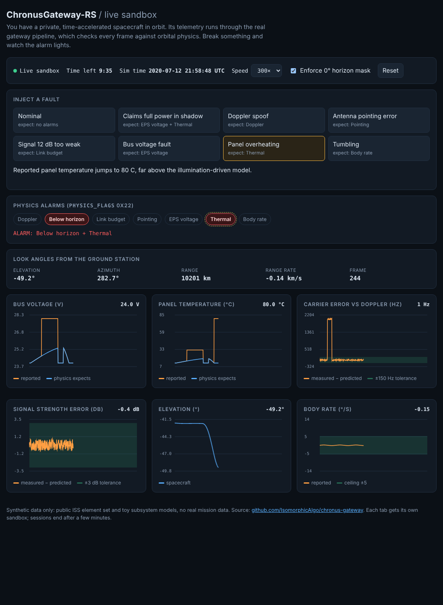

# ChronusGateway-RS

**A fast Rust gateway that turns satellite telemetry into trusted, web-ready data, and checks every frame against real orbital physics.**

[](https://github.com/IsomorphicAlgo/chronus-gateway/actions/workflows/ci.yml)
[](LICENSE)

**[Live sandbox](https://demo.chronusgateway.com)** · **[Website](https://chronusgateway.com)** · [Operator guide](docs/USER_GUIDE.md) · [Changelog](CHANGELOG.md)



*The live sandbox mid-demo. A visitor has injected a panel-overheating fault; the gateway flags it because the reported temperature disagrees with what the spacecraft's orbital position allows.*

---

## Try it

**In your browser:** open the **[live sandbox](https://demo.chronusgateway.com)**. You get a private, time-accelerated simulated spacecraft. Pick a fault (fake a Doppler shift, claim full solar power while in Earth's shadow, point the antenna the wrong way) and watch the matching alarm light up. Nobody else sees your faults.

**On your machine** (Rust 1.89+):

```bash
# The hosted sandbox, locally: http://127.0.0.1:8080
STATIC_DIR=demo/sandbox cargo run --release -p chronus-demo-server

# Or the real UDP gateway, fed by the synthetic spacecraft simulator:
cargo run -p chronus-gateway                                   # terminal 1
cargo run -p chronus-hil-sim --release -- 127.0.0.1:7301 2000  # terminal 2
```

Full runbooks: [`docs/DEMO.md`](docs/DEMO.md) (native, Docker, replay, fixtures) and [`docs/PUBLIC_DEMO.md`](docs/PUBLIC_DEMO.md) (hosting the sandbox yourself).

---

## What it does

Imagine a satellite circling Earth, constantly whispering raw binary to a ground station. ChronusGateway-RS is the **translator and sanity-checker** for those whispers. It ingests CCSDS packets over UDP, validates them against physics computed in real time, and streams clean JSON to mission-control dashboards, including [NASA Open MCT](https://nasa.github.io/openmct/)–compatible clients.

### 1. Fast translator

An async, non-blocking core (Tokio) handles ingestion, parsing, and WebSocket fan-out so frames never pile up. Each CCSDS Space Packet becomes one `openmct.realtime.v1` JSON message.

### 2. Built-in space map

A live orbital engine, [**Ephemerust**](#ephemerust), tracks where the spacecraft is, how fast it is moving, and how it looks from your ground site: azimuth, elevation, range, and range-rate, updated on each frame. The orbit comes from a TLE or, when the operator has one, a precise **CCSDS OEM ephemeris** (GCRF, EME2000, TEME or ITRF). Optional Earth orientation data (UT1−UTC, polar motion) and atmospheric refraction put the computed direction where a real antenna points.

### 3. Physics as a sanity check

Instead of trusting every field on the wire, the gateway runs **Physics–Telemetry Co-Validation**: what the packet claims is compared to what physics allows, and any disagreement sets a bit in `physics_flags` on that frame, so operators and automation see a mismatch rather than a silent pass.

| Bit | Alarm | Raised when |
|----:|-------|-------------|
| 0 | Doppler | the measured carrier differs from the range-rate prediction by more than the tolerance (150 Hz default, optionally widened by the TLE's age) |
| 1 | Below horizon | the spacecraft is below your minimum elevation |
| 2 | Link budget | received power disagrees with the free-space prediction (3 dB default) |
| 3 | Pointing | measured antenna direction differs from the computed, refraction-corrected look angle (0.25° default) |
| 4 | EPS voltage | reported bus voltage disagrees with the sun-illumination model |
| 5 | Thermal | reported panel temperature disagrees with the sun-illumination model |
| 6 | Body rate | reported body rate exceeds the attitude ceiling (5 °/s default) |
| 7 | Reserved | |

**The shadow check.** A packet claims "full solar power" while the propagator says the spacecraft is in Earth's shadow. The frame is flagged.

**The Doppler check.** A moving satellite shifts the carrier frequency you should see at the antenna. The gateway computes the non-relativistic shift from range-rate and your nominal carrier $f_0$:

```math
\Delta f = -f_0 \, \frac{\mathbf{v}_{\mathrm{rel}} \cdot \mathbf{r}_{\mathrm{rel}}}{c \, \lVert \mathbf{r}_{\mathrm{rel}} \rVert}
```

A static or wrong-frequency spoof does not line up with the live orbital solution, so it is flagged. Bit semantics and tolerances are specified in [`Methodology.md`](Methodology.md) (D-016) and the [`validate`](crates/gateway/src/validate.rs) module docs.

---

## Ephemerust

[**Ephemerust**](https://github.com/IsomorphicAlgo/Ephemerust) ([crates.io](https://crates.io/crates/ephemerust)) is the physics engine behind the gateway: a Rust astrodynamics library built on SGP4.

- **Look angles** (azimuth, elevation, slant range) from any ground site.
- **Range-rate**, the input to the Doppler check.
- **A conical umbra/penumbra eclipse model**, the input to the shadow check and the EPS/thermal sun-illumination model.

The gateway reaches it through an `OrbitalPropagator` trait, so the network and validation pipeline never depend on a specific math library. Ephemerust (version 1.x) drives the default TLE backend, and the same boundary hosts the second backend, which reads operator OEM ephemerides through Ephemerust's IAU 2006/2000B frame chain; a numerical propagator such as `nyx-space` could drop in the same way. Ephemerust's satellite math is tested against an independent IAU 2000 reference (Skyfield): under an arcminute in pointing and under half a metre per second in range-rate, about 0.6 Hz of Doppler at 437.5 MHz. Rationale: [`Methodology.md`](Methodology.md) (D-001, D-004, D-037, D-041 to D-045).

---

## The sandbox

The [hosted sandbox](https://demo.chronusgateway.com) is a separate crate, [`chronus-demo-server`](crates/chronus-demo-server/), that gives every browser tab its own simulated spacecraft.

- **Same pipeline.** Each frame is encoded to real CCSDS bytes, then parsed, co-validated and serialized by the same code path as the UDP gateway (`http::process_frame_with_rf`). Only the UDP hop is replaced by an in-process hand-off.
- **Private and time-accelerated.** A session has its own simulated clock (60× by default, so one ISS orbit takes about 92 seconds) and its own gateway state. It starts a few minutes before an overhead pass, so the spacecraft rises almost immediately.
- **Eight scenarios,** each perturbing exactly one thing: nominal, shadow-power claim, Doppler spoof, pointing error, weak signal, bus-voltage fault, overheating, and tumbling.
- **Safe to expose.** No UDP socket and no uploads. Global and per-IP session caps, an `Origin` allow-list, a hard session lifetime, tiny inbound messages, a command rate limit, and scale-to-zero hosting on Fly.io.
- **Data is synthetic.** Public ISS element set and toy subsystem models only.

The landing page lives in [`site/`](site/) and is deployed to [chronusgateway.com](https://chronusgateway.com) with GitHub Pages. See [`docs/PUBLIC_DEMO.md`](docs/PUBLIC_DEMO.md) for deploy, DNS and operations.

---

## Architecture

```
Raw RF / SDR ──▶ Async UDP ingestion ──▶ CCSDS zero-copy parser ──▶ Physics-Telemetry
 (UDP)            (Tokio)                  (validated frames)         Co-Validation engine
                                                                             │
                  OrbitalPropagator trait ◀── range-rate / look-angles ──────┤
                  (Ephemerust today)                                         ▼
                                                          Axum WebSocket ──▶ NASA Open MCT
```

- **Asynchronous core.** A Tokio runtime drives non-blocking UDP ingestion and a pool of WebSocket connections, scaling to many concurrent telemetry channels and operator screens.
- **Trait-based astrodynamics.** Physical-state computation sits behind the `OrbitalPropagator` trait, decoupling the pipeline from any one math library.
- **Plain-English diagnostics.** Every failure explains itself: what happened, the likely cause, and how to fix it (`CG-*` codes in [`diagnose.rs`](crates/gateway/src/diagnose.rs)).

The reasoning behind these and other choices is recorded in [`Methodology.md`](Methodology.md).

---

## Testing

Testing is a first-class deliverable. **216 tests, all passing**, in a layered suite: inline unit tests, integration tests over loopback UDP and in-process WebSockets, a NeXosim hardware-in-the-loop simulator, runnable doctests, and physics co-validation tests with explicitly documented tolerances.

| Layer | Count | Where |
|-------|------:|-------|
| Unit tests | **170** | inline `#[cfg(test)]` modules across the workspace |
| Integration tests | **20** | `crates/gateway/tests/` (UDP ingest, WebSocket distribution, public fixtures), `crates/chronus-hil-sim/tests/` (HIL soak against the real ingest loop), `crates/chronus-demo-server/tests/` (real WebSocket clients) |
| Doctests | **26** | runnable examples in the public API docs |
| Benchmarks | Criterion | [`parse_validate.rs`](crates/gateway/benches/parse_validate.rs): the parse and validate hot paths |

**What the tests assert, not just that they pass:**

- **Physics tolerances are explicit.** Doppler, link budget, pointing, and subsystem checks each have documented tolerances, with tests on both sides of the boundary.
- **Errors are tested for what they tell the operator.** Each `CG-*` diagnostic has tests for its cause and suggested fix. A latitude of -122.3 is recognised as a swapped latitude/longitude, and a port conflict suggests the next free port and the `netstat`/`lsof` command to find the culprit.
- **The sandbox is checked end to end.** Nominal telemetry raises no alarm over a full orbit; every fault scenario raises exactly its documented `physics_flags` bit; one visitor's fault never reaches another's session; the per-IP cap, `Origin` allow-list and session time limit are enforced over real WebSockets.
- **Parsers are fuzzed.** Property tests (`proptest`) throw arbitrary bytes at the CCSDS parser.

**CI gates** ([`ci.yml`](.github/workflows/ci.yml)) on every push and pull request: `cargo test`, `clippy -D warnings`, benchmark compilation, a Docker Compose spec check, the demo dashboard build, plus supply-chain checks with `cargo audit` and `cargo deny`.

```bash
cargo test --workspace          # everything above
cargo bench -p chronus-gateway  # Criterion benchmarks
```

Manual acceptance for the demo paths is in [`docs/Demo_Test.md`](docs/Demo_Test.md).

---

## Repository layout

```
chronus-gateway/
├── Cargo.toml              Workspace manifest (edition 2024, MSRV 1.89)
├── fly.toml                Fly.io config for the public sandbox
├── gateway.example.toml    Example config for `chronus-gateway --config`
├── crates/
│   ├── gateway/            The gateway library + binary: ingest, CCSDS parser,
│   │                       physics co-validation, Axum/WebSocket, diagnostics
│   ├── chronus-hil-sim/    NeXosim synthetic spacecraft → UDP, with scripted faults
│   ├── chronus-replay/     Replay hex/JSONL CCSDS datagrams into the gateway
│   └── chronus-demo-server/ Per-visitor sandbox server (not published to crates.io)
├── demo/
│   ├── sandbox/            The visitor page served by the hosted sandbox
│   ├── dashboard/          Vite + TypeScript live view of a running gateway
│   ├── fixtures/, replay/  ISS + AMSAT-themed and golden CCSDS fixtures
│   ├── Dockerfile, docker-compose.yml   Local demo stack
│   └── Dockerfile.public   Image for the public sandbox
├── site/                   Landing page (GitHub Pages → chronusgateway.com)
├── docs/                   USER_GUIDE, DEMO, PUBLIC_DEMO, HIL, Demo_Test, screenshots
└── Methodology.md          Decision log: the reasoning behind major choices
```

Publishing `chronus-gateway` or `chronus-hil-sim` to [crates.io](https://crates.io) uploads only the source under `crates/<name>/`, so demo assets stay out of dependents' builds ([`Methodology.md`](Methodology.md) D-025).

---

## Building and running

Rust **edition 2024**, MSRV **1.89**. All dependencies, including [Ephemerust](https://crates.io/crates/ephemerust), resolve from crates.io, so a plain clone-and-build works:

```bash
cargo build                                    # compile the workspace
cargo run -p chronus-gateway                   # UDP ingest 127.0.0.1:7301 + HTTP/WebSocket 127.0.0.1:8080
cargo run -p chronus-gateway -- --config gateway.example.toml
cargo run -p chronus-hil-sim --release -- 127.0.0.1:7301 2000        # synthetic spacecraft (gateway first)
cargo run -p chronus-replay -- --file demo/replay/fixtures/golden_tm.hex --repeat 2
```

Add a scripted fault to the simulator to see the CV-4/CV-5 alarms (bits 4–6):

```bash
cargo run -p chronus-hil-sim --release -- 127.0.0.1:7301 500 \
  --scripted-anomaly eps-voltage --anomaly-after-frame 40 --anomaly-frame-count 25
```

Connect any WebSocket client to `ws://127.0.0.1:8080/telemetry/openmct`, or open the [dashboard](demo/dashboard/). Check health at `http://127.0.0.1:8080/api/v1/chronus/status`. Settings can come from TOML (`--config`, or `CHRONUS_GATEWAY_CONFIG`; the CLI wins when both are set), and `RUST_LOG=debug` turns on verbose tracing. Default bind addresses are loopback-only.

---

## Documentation

| Topic | Doc |
|-------|-----|
| **Operators**: install, run, read `physics_flags` | [`docs/USER_GUIDE.md`](docs/USER_GUIDE.md) |
| Demo runbook: native, Docker, dashboard, replay | [`docs/DEMO.md`](docs/DEMO.md) |
| Hosting the public sandbox (Fly.io + custom domain) | [`docs/PUBLIC_DEMO.md`](docs/PUBLIC_DEMO.md) |
| HIL profiling | [`docs/HIL.md`](docs/HIL.md) |
| Demo acceptance checks | [`docs/Demo_Test.md`](docs/Demo_Test.md) |
| Config file | [`gateway.example.toml`](gateway.example.toml) |
| Decision log | [`Methodology.md`](Methodology.md) |
| Version history | [`CHANGELOG.md`](CHANGELOG.md) |

---

## Acknowledgements

Full dependency rationale lives in [`Methodology.md`](Methodology.md) § Attribution.

- **[Ephemerust](https://crates.io/crates/ephemerust)**: SGP4 look-angles, range-rate, and the conical umbra/penumbra eclipse model (published crate; same maintainer).
- **[`sgp4`](https://crates.io/crates/sgp4)**: SGP4/SDP4 numerics, used through Ephemerust.
- **[CCSDS](https://public.ccsds.org/)** and **[NASA Open MCT](https://nasa.github.io/openmct/)**: the open packet standard the gateway ingests and the mission-control UX the JSON targets.

| Crate | Role |
|-------|------|
| [`spacepackets`](https://crates.io/crates/spacepackets) | CCSDS Space Packet primary-header parsing |
| [`nexosim`](https://crates.io/crates/nexosim) | Discrete-event HIL spacecraft driver |
| [`tokio`](https://crates.io/crates/tokio), [`tokio-util`](https://crates.io/crates/tokio-util) | Async runtime, UDP ingest, shutdown |
| [`axum`](https://crates.io/crates/axum), [`tower`](https://crates.io/crates/tower), [`tower-http`](https://crates.io/crates/tower-http) | HTTP + WebSocket distribution, static files |
| [`tracing`](https://crates.io/crates/tracing), [`tracing-subscriber`](https://crates.io/crates/tracing-subscriber) | Structured logging |
| [`serde`](https://crates.io/crates/serde), [`serde_json`](https://crates.io/crates/serde_json), [`chrono`](https://crates.io/crates/chrono), [`toml`](https://crates.io/crates/toml) | JSON telemetry, timestamps, config |
| [`anyhow`](https://crates.io/crates/anyhow), [`thiserror`](https://crates.io/crates/thiserror), [`clap`](https://crates.io/crates/clap) | Errors and CLIs |
| [`criterion`](https://crates.io/crates/criterion), [`proptest`](https://crates.io/crates/proptest), [`tokio-tungstenite`](https://crates.io/crates/tokio-tungstenite) | Benchmarks, parser fuzzing, WebSocket tests |
| [`cargo-audit`](https://crates.io/crates/cargo-audit), [`cargo-deny`](https://crates.io/crates/cargo-deny) | Supply-chain CI |
| [Vite](https://vitejs.dev/) | Demo dashboard bundler |

---

## License and compliance

Licensed under the MIT License; see [`LICENSE`](LICENSE) (also shipped inside each published crate).

This project is built strictly on open international standards (CCSDS) and is published openly under the Public Domain and Fundamental Research exclusions of ITAR/EAR. All demo data is synthetic or public. See [`Methodology.md`](Methodology.md) for compliance, attribution, and security expectations.
