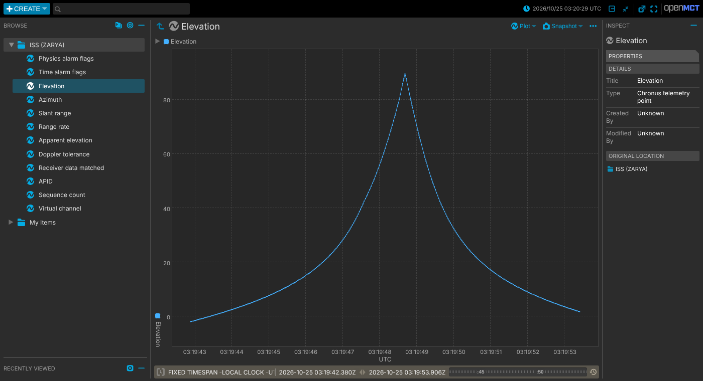
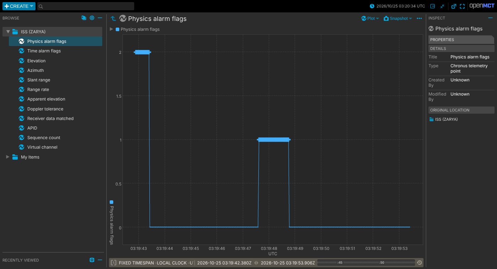

# Open MCT: dictionary, history and the published schemas

*Added in 0.5.0 (Tranche 3 of the 1.0 plan, Methodology D-049).*

Before 0.5.0 the gateway streamed `openmct.realtime.v1` messages over a WebSocket, and that was all.
The dictionary and history endpoints were stubs, so a dashboard that connected late, or a browser
tab that was reloaded, started from an empty screen.

Now the gateway keeps **recent history**, generates a **telemetry dictionary**, and publishes
**JSON Schemas** for everything it emits. `demo/openmct/` wires these into a real
[NASA Open MCT](https://github.com/nasa/openmct) instance.



*A lab ISS pass in Open MCT. The gateway was killed (`kill -9`) and restarted before this
screenshot. Every point was reloaded from its history file and served through the history API.*

---

## 1. History

Every message the gateway emits is also kept in a bounded ring buffer:

```toml
[history]
capacity = 10000                    # messages kept in memory (default); 0 turns history off
# persist_path = "history.jsonl"    # optional: survive restarts
```

- **Memory:** about 1 KB per message, so the default holds roughly 10 MB. The oldest messages are
  dropped first. The upper limit is 500 000.
- **File (optional):** each message is appended as one JSON line, and the newest `capacity` lines
  are reloaded at startup. The file is compacted back to `capacity` lines whenever it reaches
  twice that, so it is bounded too. Writes happen on their own thread and are flushed after every
  batch, so a crash loses at most what was in flight. If the disk falls behind, messages are still
  kept in memory, and the skipped writes are counted (`CG-514`).
- **Processed once.** Since 0.5.0, one pipeline task parses and validates each packet **once** and
  publishes the result to history and to every WebSocket client. Before, each client did its own
  processing, so physics ran once per client and nothing was processed while no dashboard was
  connected.

### `GET /api/v1/chronus/history`

| Parameter | Meaning |
|---|---|
| `start`, `end` | Inclusive bounds on the ground receipt time: milliseconds since 1970 (what Open MCT sends) or RFC 3339 |
| `apid` | Only this APID (decimal or `0x` hex) |
| `limit` | At most this many messages (default 1000, maximum 10 000). When more match, the **newest** are returned and `truncated` is `true` |

```json
{"chronus_schema":"chronus.history.v1","start":null,"end":null,"apid":null,
 "count":2,"truncated":false,"capacity":10000,
 "messages":[{"chronus_schema":"openmct.realtime.v1","apid":288, ...}, ...]}
```

Messages come oldest first and are byte-for-byte what the WebSocket sent. Bad parameters get a
`400` with an `error` and a `fix`, in the same plain-English style as `/status`.

## 2. The telemetry dictionary

`GET /api/v1/chronus/openmct/dictionary` lists every telemetry point. Each point is a numeric field
of the realtime message (`chronus_field`), with an Open MCT `value` range and a `utc` domain (the
ground receipt time):

| Key | Field | Units |
|---|---|---|
| `chronus.tm.physics_flags` | `physics_flags` | bitfield; alarms when non-zero |
| `chronus.tm.physics_flags_v2` | `physics_flags_v2` | bitfield; alarms when non-zero |
| `chronus.physics.elevation_deg` | `elevation_deg` | deg |
| `chronus.physics.azimuth_deg` | `azimuth_deg` | deg |
| `chronus.physics.range_km` | `range_km` | km |
| `chronus.physics.range_rate_km_s` | `range_rate_km_s` | km/s |
| `chronus.physics.apparent_elevation_deg` | `apparent_elevation_deg` | deg |
| `chronus.physics.doppler_tolerance_hz` | `doppler_tolerance_hz` | Hz |
| `chronus.rf.matched` | `rf_matched` | 0/1 |
| `chronus.tm.apid`, `chronus.tm.seq_count`, `chronus.tm.vcid` | packet identity | |

The dictionary also names the tracked spacecraft (taken from the TLE title line, for example
`ISS (ZARYA)`) and describes each alarm bit in `flag_bits`. It is generated from a single table in
`crates/gateway/src/openmct.rs`. The per-point history below and the Open MCT plugin use the same
table, so the three cannot drift apart.

### `GET /api/v1/chronus/openmct/history/{key}?start=&end=`

One point's history, in the datum shape Open MCT's telemetry API expects:

```json
[{"id":"chronus.physics.elevation_deg","timestamp":1792898382880,"value":-1.97}, ...]
```

Messages where the point has no value are skipped, for example physics fields when no TLE is
loaded. An unknown key returns `404` with the list of valid keys.

## 3. Published JSON Schemas

| Schema | Describes | Served at |
|---|---|---|
| `openmct.realtime.v1` | one WebSocket / history message | `/api/v1/chronus/schemas/openmct.realtime.v1` |
| `chronus.rf.v1` | one receiver-measurement datagram ([RF_SIDE_CHANNEL.md](RF_SIDE_CHANNEL.md)) | `/api/v1/chronus/schemas/chronus.rf.v1` |
| `chronus.history.v1` | the history response | `/api/v1/chronus/schemas/chronus.history.v1` |
| `chronus.openmct.dictionary.v1` | the dictionary | `/api/v1/chronus/schemas/chronus.openmct.dictionary.v1` |

The source files are in [`crates/gateway/schemas/`](../crates/gateway/schemas/) (JSON Schema draft
2020-12). `GET /api/v1/chronus/schemas` lists them.

The **v1 rule** is additive only. Consumers must ignore fields they don't know. Fields added after
the first release (`physics_flags_v2`, `onboard_time`, `physics_time`, `rf_matched`, `vcid`, and so
on) are optional in the schema, so a validator built from it also accepts output from older
gateways. `crates/gateway/tests/schemas.rs` validates **real gateway output** against each schema,
and checks that malformed documents fail.

## 4. The Open MCT demo

[`demo/openmct/`](../demo/openmct/) is a small Vite project around the prebuilt Open MCT 4.3.1 plus
a ~150-line plugin (`src/chronus-plugin.js`) that:

- builds the object tree from the dictionary (one folder named after the spacecraft, one object per
  point);
- answers Open MCT's historical requests from `/openmct/history/{key}`;
- shares **one** WebSocket across every subscribed point and projects each message onto them;
- turns the alarm bitfields red when they are non-zero.

```bash
cargo run -p chronus-gateway -- --config gateway.toml   # with [history]; port 8080
cd demo/openmct && npm install && npm run dev           # http://127.0.0.1:5174
cargo run -p chronus-replay -- -f demo/replay/fixtures/iss_pass_lab.jsonl --rf-dest 127.0.0.1:7302 --delay-ms 30
```

The Vite server proxies `/api` and `/telemetry` to the gateway (`CHRONUS_GATEWAY=http://host:port`
to change it). The gateway sends no CORS headers, so the browser talks to it same-origin.

**The exit check.** `demo/openmct/verify_history.py` (Python Playwright, headless Chromium) opens a
point in a Telemetry Table, sends more telemetry, and reloads the page. It checks that the history
rows load, that new rows arrive live, and that every row is still there after the reload:

```text
history on load:     75 row(s)
after realtime send: 90 row(s)
after page reload:   90 row(s)
PASS
```


